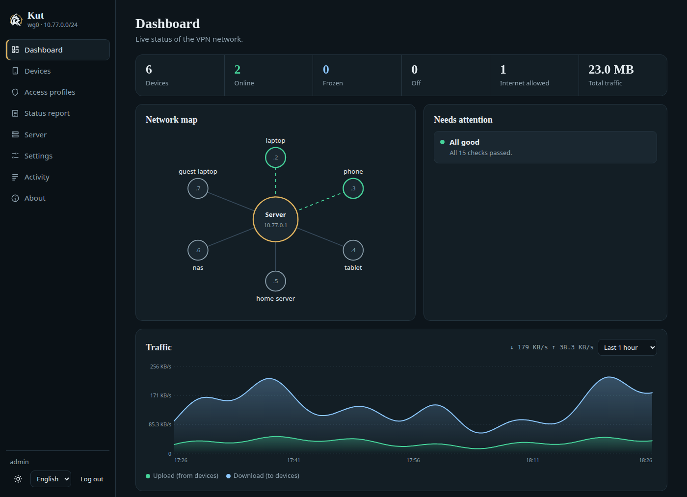
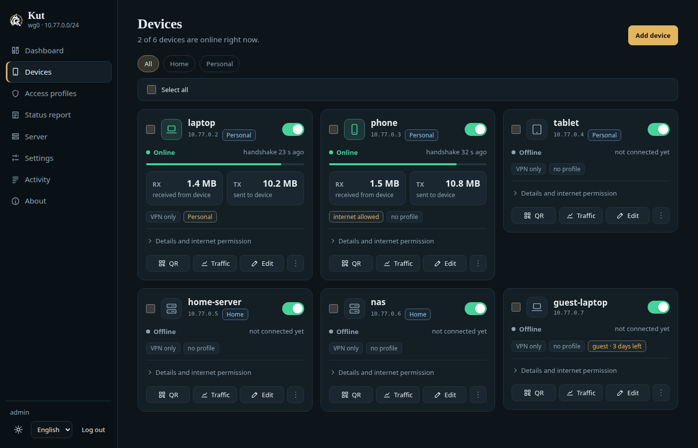
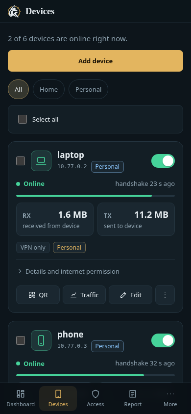
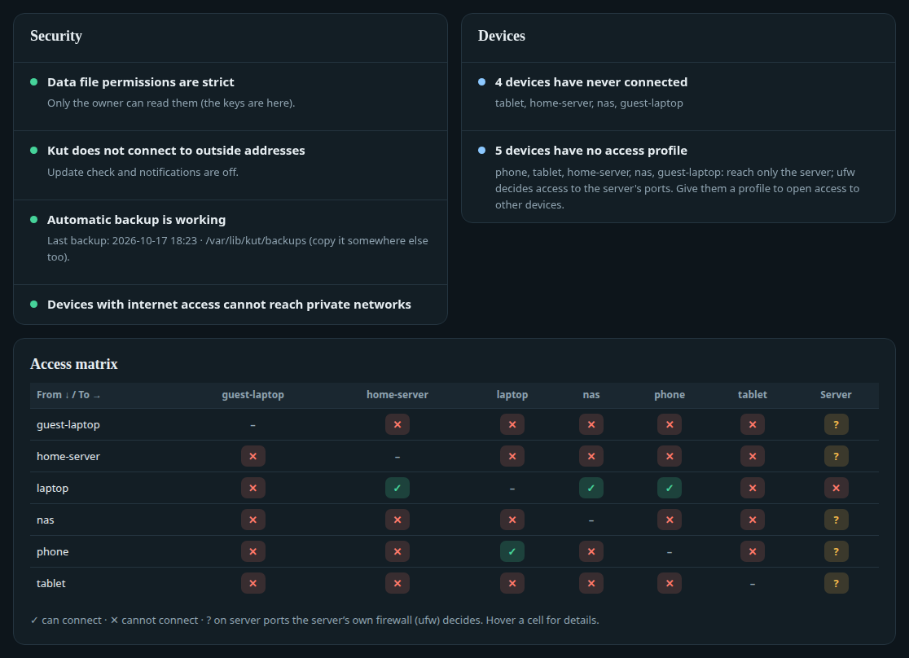
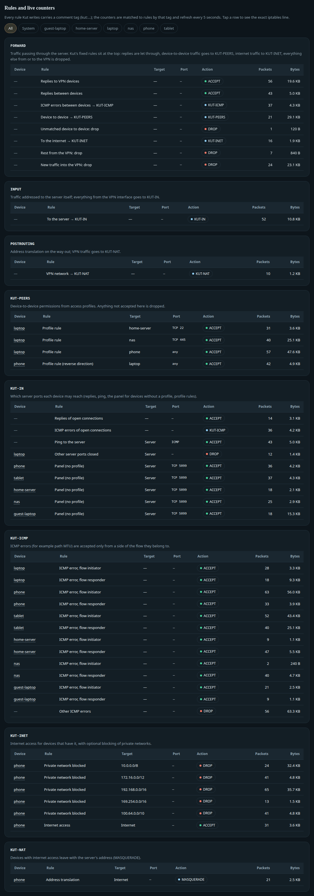
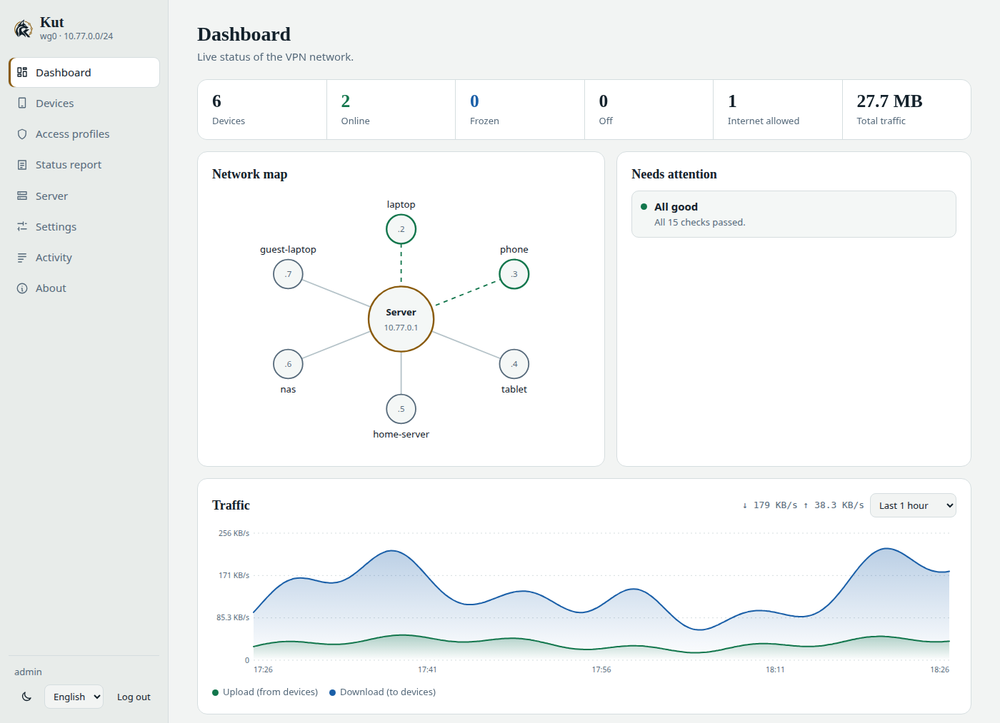

<p align="center">
  <picture>
    <source media="(prefers-color-scheme: dark)" srcset="docs/brand/kut-logo-dark.svg">
    <source media="(prefers-color-scheme: light)" srcset="docs/brand/kut-logo-light.svg">
    
  </picture>
</p>

# Kut

A single-binary admin panel for WireGuard. Go standard library only, zero dependencies, no Docker.

*Kut* is Old Turkic for "fortune, good luck, life force" — short, easy to say, and not foreign to English speakers either.

**Design:** hub-and-spoke VPN. Devices connect to the server and the server forwards traffic between them. By default nobody's internet traffic goes through the VPN; "internet exit" can be enabled per device.



| | |
|---|---|
| <br>Devices: live status, traffic, group and access profile per device. | <br>The same list on a phone, with the bottom navigation bar. |
| <br>Status report: security and device checks plus the device-to-device access matrix. | <br>Server tab: every rule Kut writes, with live packet and byte counters. |
| <br>Dashboard in the light theme. | |

<sub>Screenshots use made-up demo data (`make screenshots`).</sub>

> 🇹🇷 Türkçe özet için: [Türkçe özet](#türkçe-özet)

## Installation (Ubuntu / Debian)

The binary carries the installer (`install.sh` and `kut.service` are embedded), so a release is just the binary and `SHA256SUMS`:

```sh
V=0.15.0; A=amd64            # or arm64
curl -fLO https://github.com/yfthcn/kut/releases/download/v$V/kut-linux-$A
curl -fLO https://github.com/yfthcn/kut/releases/download/v$V/SHA256SUMS
sha256sum -c --ignore-missing SHA256SUMS     # must print "kut-linux-amd64: OK"
chmod +x kut-linux-$A && sudo ./kut-linux-$A install
```

`kut install` accepts the same options as `install.sh` (`--endpoint`, `--port`, `--subnet`, `--iface`, `--device`, `--lang`, `--yes`) and installs the running binary as `/usr/local/bin/kut`. From source: `make linux` builds both binaries and `dist/SHA256SUMS`; `sudo ./install.sh` in the source tree still works on its own.

The wizard first asks for the language (Turkish/English; `--lang tr|en`, otherwise guessed from `$LANG`), then for: the endpoint (public IP or domain name), UDP port, VPN subnet (with an overlap check), interface name, admin password and a first device. At the end it runs a health check and **draws the first device's QR code in the terminal** so you can scan it with your phone — no SSH tunnel needed. Unattended install: `sudo ./install.sh --endpoint 203.0.113.10 --yes` (the password is read from the `KUT_PASSWORD` environment variable).

The install script does **not** ask a third-party service (such as `ifconfig.me`) for your public IP; the server's address never leaves the machine. Without `--endpoint`, the wizard lists this machine's local IPs and asks you for the endpoint (there is no default; your hosting panel shows the public IP). With `--yes`, `--endpoint` is required and the script stops with an error otherwise.

The only manual step: open the UDP port (51820) in your provider's firewall.

### Updating

Download the new binary and `SHA256SUMS` as above, verify, then run `sudo ./kut-linux-amd64 install` again. It detects the existing installation and upgrades it: keys, devices and settings are kept, the service is restarted, and the firewall rules are migrated in place (new rules are inserted before old ones are deleted, so there is no moment without them). Running `sudo kut install` from the installed binary is also fine; it does not copy the file over itself.

### Uninstalling

```sh
sudo kut uninstall              # lists what will be removed and asks; -yes skips the question, -dry-run only prints the list
sudo kut uninstall -purge       # also deletes /var/lib/kut (devices, keys, accounts, logs, backups)
sudo ./install.sh --uninstall   # same thing from the source tree
```

Before anything is removed, an **encrypted** backup is written to `/root/kut-uninstall-<date>.tar.gz` (password from `KUT_BACKUP_PASSWORD`, otherwise asked twice; restore it with `kut restore -f`). Then `kut` and `wg-quick@wg0` are stopped and disabled, and `/etc/systemd/system/kut.service`, `/usr/local/bin/kut`, `/etc/sysctl.d/99-kut.conf`, the WireGuard config (only if it is the file Kut wrote, recognised by its `# Managed by Kut` header), all `KUT-*` chains and Kut's jumps in `INPUT`, `FORWARD` and nat `POSTROUTING` (IPv4 and IPv6) are removed. The ufw rule for the WireGuard port is removed only if Kut's installer added it (it records this in `/var/lib/kut/ufw-port`); other ufw and Docker rules are never touched. `net.ipv4.ip_forward` stays on until the next reboot because other services may rely on it. Without a readable `server.json` the command does not touch any WireGuard unit or config (the `wg0` it would guess may belong to something else) and takes no backup; `-purge` only accepts a directory that contains Kut's `server.json`. If the interface is still up after stopping the units, the firewall rules are left in place rather than opening forwarding, and the command tells you to run `wg-quick down` first.

### Upgrading from v0.13 or earlier: devices without a profile

From v0.14 a device without a profile reaches **only the server** (ping, the panel port, and whatever ufw allows) and the internet if its internet permission is on; it can no longer open connections to other VPN devices. Device-to-device access is opened with a profile (a rule on the source device, or a "reciprocal" rule on the other device). After upgrading, check **Status report → Devices**: it lists the devices without a profile. To keep the old behaviour, turn on Settings → "Devices without a profile can reach each other".

### Upgrading from v0.3 (wireguard-gui)

Running the same `sudo ./install.sh` is enough; it detects the old installation. Data moves from `/var/lib/wireguard-gui` to `/var/lib/kut` (the old directory stays as `.bak`, or a timestamped name if that is taken), the old service is stopped, and keys, devices and IPs stay the same — **no change is needed on the devices**. The data schema is upgraded automatically (a `backup-schema1-…` copy is kept). Old `WGUI-*` firewall chains are removed in favour of `KUT-*` chains. An older Kut refuses data written with a newer schema.

## Interface

Bottom navigation bar on phones, side menu on desktop. Dark/light theme. Live updates over SSE, falling back to polling automatically.

**Language:** Turkish and English. Each account picks its own language (the selector is on the login screen, in the sidebar and in the "More" menu on phones); without a choice the browser language is used. A separate *server default language* applies to output without a browser (notifications, CLI, `kut doctor`); it defaults to Turkish for existing installations. Everything is translated: every view and dialog, API error messages (returned as codes and rendered in the viewer's language), the activity log (new entries are shown in the viewer's language; entries written before this release keep their original text), the status report, notifications, the CLI and the installer. Server-generated text (status report, firewall state, access-test reasons) follows the language the browser sends in `X-Kut-Lang`. Change the server default language under Settings → Server language. Catalogs live in `web/locales/<lang>/*.json` (one file per section, merged at startup; a key defined twice stops the binary from starting, which the tests catch).

| Tab | Contents |
|---|---|
| **Dashboard** | Counters, network map (who is connected), last-hour traffic chart, items needing attention, device table. |
| **Devices** | Cards: add (assign the IP yourself, with instant valid/free/conflict checks), enable/disable, freeze, edit, regenerate, delete. |
| **Access profiles** | Optional. Which devices and server ports a device may reach, with port descriptions (e.g. `8096 — Jellyfin`). Try it with "Access test". |
| **Status report** | Health summary, grouped checks (with suggested fixes), structure, access matrix, system information. |
| **Server** | WireGuard status, firewall skeleton and generated rules, masked `wg0.conf`, re-apply. |
| **Settings** | Endpoint, port, DNS, MTU, keepalive, private-network block, update check (optional), password. |
| **Activity** | Who did what, and when. |
| **About** | Version, build, GitHub/site links, manual update check. |

Editing the raw `wg0.conf`/PostUp is deliberately not possible: one wrong line can lock you out of the VPN.

### About and update check: fully optional
Off by **default**. While the update check and notification channels are off, Kut makes no outbound connections, with two exceptions: (1) the **"Check now"** button an administrator presses on the About page (a single request to GitHub; at most once every 30 s, showing the last result in between) and (2) when your endpoint is a domain name, the Status report / `kut doctor` **resolves that name via DNS** (only that name is sent to the system resolver). When enabled, Kut asks GitHub "what is the latest release" once a day; it sends no data and installs nothing on its own. Failures break nothing.

## Access profiles and firewall

A profile is a list of rules: *target* (server / one device / all devices) + *type* (TCP, UDP, ping, all) + *ports* (`80,443,8000-8100`) + description + *reciprocal* (for device targets).

- **A device without a profile** reaches only the server: ping, the panel port, and whatever the server's own firewall (ufw) allows. It cannot open connections to other devices; the only exception is the return direction of a "reciprocal" rule in another device's profile. The setting "Devices without a profile can reach each other" (off by default) restores the pre-v0.14 behaviour, where such a device is free inside the VPN.
- **A device with a profile** is allow-listed: anything not written down is **dropped** on the server. Permissions are directional (A→B does not imply B→A; tick "reciprocal" if you want both).
- Ping to the server is always allowed. A device with a profile reaches the panel port only if a rule says so.
- **Rule schedule:** every rule can have an optional day/time window (e.g. a game port on weekdays 16:00–21:00). Outside the window the rule behaves as if it did not exist; at the boundary Kut updates the firewall by itself (`rule_schedule` in the activity log). The access test reports out-of-window denials separately. Times are server time.
- **Group default:** if a profile lists "default groups", devices in those groups that have no profile of their own use it; newly added devices start restricted too. A profile assigned to the device directly wins. A group can be the default of only one profile.
- **Internet exit** is per device, independent of profiles, and has two separate parts: (1) **server permission** — the "Internet exit permission" switch on the card, applied instantly, has the final say; when off, internet traffic is dropped on the server whatever the client config says. (2) **client routing** — `AllowedIPs`/DNS in the device's config; the server cannot see it, and changing it requires "Regenerate". Next to the permission the card shows actual use (from the KUT-INET counters: whether the device sent internet traffic through the tunnel, how much, and when).
- Every device has a `/32`, so WireGuard does not allow source IP spoofing; IP-based rules can be trusted.
- **Revoking a permission also cuts established flows on the next packet.** For device-to-device and server-port traffic, the `ESTABLISHED,RELATED` accept rule at the top of the skeleton only applies to the **reply direction** (`--ctdir REPLY`). When a rule is removed, a profile changes or a rule window ends, the next packet sent by the device that opened the connection is evaluated against the profile again and dropped; the conntrack entry may linger until it times out, but the flow stops. Internet exit is cut the same way (outgoing packets are checked by `KUT-INET`).
- **ICMP errors only from the flow's own endpoints.** ICMP errors tied to an existing flow ("fragmentation needed" / "packet too big" for path MTU discovery, port unreachable) pass between devices and to the server only if the sender is one of the two endpoints of that flow (`KUT-ICMP`: `--ctorigsrc`/`--ctreplsrc` per device). A third device that knows the flow cannot inject fake errors into it; if `KUT-ICMP` is empty or broken, such errors are dropped (path MTU discovery suffers, access does not open). Known limit: this check follows the conntrack entry, not the profile, so after a permission is revoked the former endpoint can still send ICMP errors into that dead flow until its conntrack entry expires (no data passes).

Implementation: Kut manages only its own `KUT-PEERS`, `KUT-IN`, `KUT-INET`, `KUT-ICMP` and `KUT-NAT` chains (it does not touch ufw). Fixed skeleton rules sit at the top of `FORWARD`/`INPUT`/`nat POSTROUTING`; chain contents are replaced atomically with `iptables-restore --noflush`. **Fail-closed applies to `FORWARD` only:** with empty chains nothing passes between devices or to the internet. The final `-o wg0 -j DROP` rule in `FORWARD` also blocks new connections from other interfaces (LAN, Docker, …) to VPN devices, even when the host's default policy is `ACCEPT`. In `INPUT` (the server's own ports) a device without a profile falls through to the host firewall (ufw); apart from the panel port Kut adds no rules for it. Kut verifies the rules every 15 s and repairs them — including a missing or reordered skeleton — if they drift.

## Device groups and bulk actions

Give devices a **Group** label (Family, Work, …) and filter by group on the Devices page. Select several devices with the card checkboxes (or "Select all") and enable/disable, freeze, assign a profile, change the internet permission, set validity/access hours, assign a group or delete them in one action. A bulk action is applied completely or not at all.

## Access hours

Define a day + time window per device (server local time; windows may cross midnight, e.g. 22:00–06:00). Two scopes: **connection** (outside the window the VPN does not work at all) or **internet** (only internet exit is cut, the VPN network keeps working). Window changes take effect within 15 s and are logged.

## Traffic charts

Every device card has **Traffic**; history is kept at 1 hour / 24 hours / 7 days / 30 days resolution and written to disk as `history.json.gz` (every 10 minutes and on shutdown), so it survives a restart. Charts draw smooth curves; hovering (tapping on touch screens) shows the download/upload rate and time at that point.

## Accounts and roles

"admin" is the **owner** account (`kut passwd`, cannot be deleted). Add more accounts under Settings → Accounts: an **Administrator** can manage everything except owner-only operations (backups, see below), a **Viewer** can only look (and change their own password and 2FA). Every account has its own password and 2FA; the activity log shows who did what. Changing a role or password closes that account's open sessions. Accounts with any other role string are refused (default deny). The login screen always shows the username field (default `admin`). Recovery: `sudo kut passwd -user ayse`, `sudo kut 2fa-off -user ayse` (when the service is running, `kut passwd` goes through it so the change takes effect immediately).

## IPv6 (optional)

Settings → IPv6. Enabling it makes the tunnel dual-stack: a random ULA /64 is generated and each device's IPv6 address is derived from its IPv4 address (10.77.0.5 → fdXX:…::5); profile rules apply to IPv6 as well (separate `ip6tables` chains; fail-closed in `FORWARD`, the same limits as above). If the server has a global IPv6 route, devices with internet permission exit over NAT66; otherwise IPv6 traffic stops at the tunnel. When enabling, Kut sets `accept_ra=2` on the default-route interface so the server's own IPv6 keeps working, then turns on forwarding. Existing devices must regenerate their config to use IPv6. Disabling removes the IPv6 rules and address.

## Backups and data retention

Settings → Backups / Data retention.

**Backup operations are owner-only.** A backup contains every account's password hash and TOTP secret, the server private key and the pre-shared keys, so creating, downloading, uploading, restoring and deleting backups and changing backup encryption are open only to the owner account (`admin`) and the local CLI socket. Other Administrators see the backup list but get 403 for these actions (the controls are disabled for them). From the web, taking, downloading or restoring a backup and changing/turning off the backup password additionally ask for the owner's **current password** and, when the owner has 2FA, a **verification code** (or a recovery code): a stolen session cannot take a backup, download it or turn off encryption — the same bar as turning off 2FA. Wrong attempts count towards the login rate limit. Schedule and retention settings are saved with the session alone; the restore preview writes nothing and needs no password; the local CLI socket (root) is exempt.

- **Automatic backups:** on by default, every day at 03:30, the last 7 are kept. Frequency (daily/weekly/monthly), time and count are configurable. If the server was off at the scheduled time, the backup is taken when it comes back. There is also a manual "Back up now" and download. The retention count prunes only automatic backups (last N) and pre-restore backups (last 5); **manual backups (`kut-elle-…`) are never deleted** — delete them yourself if you want. The list is sorted newest first.
- **Backups** live in `/var/lib/kut/backups/` (0700). They contain the server private key; if the disk fails they go with it, so download one now and then and store it elsewhere.
- **Encryption:** if you set a "Backup password", new backups are encrypted with AES-256-GCM (`.tar.gz.enc`; key from PBKDF2-HMAC-SHA256, 600 000 iterations; the header is authenticated too, tampering makes it unreadable). The password is stored on the server in `maint.json` (0600) so automatic backups can be encrypted; it is not put into the backup and never sent back to the UI. It protects a backup you downloaded or copied from leaking; someone with root on the server already has the live keys. **If you lose the password, encrypted backups cannot be opened.** After a password change, old backups still open with the old password. Uploads are sent as `multipart/form-data`, so the backup password, owner password and 2FA code travel in the request body; only a download sends the owner password and code in the `X-Kut-Owner-Pass` / `X-Kut-Owner-Code` headers (never in the URL). Wrong backup passwords count towards a separate limit of 5 attempts per minute per IP (attempts also count toward the shared login limits). Kut does not log them, but if you put a reverse proxy or logger in front of the panel, **make sure it does not log custom headers** (default formats do not).
- **Restore:** "Restore" from the list, or upload a file. The backup is validated first (corrupt or foreign files are refused, and its contents must pass the same checks as the panel API: names, keys, IPs, subnet, settings, accounts, notification settings; `conf_path` must be `/etc/wireguard/<iface>.conf`). Right before restoring, a `oncesi` (pre-restore) backup of the current state is taken (the last 5 are kept), the files are written and Kut restarts itself (`Restart=always`). All sessions are closed and the password reverts to the one in the backup. `kut restore` still works while the service is stopped and behaves **exactly like the web restore** (same file-writing code): the previous version of every file stays as `.bak`, known files missing from the backup (e.g. `peers.json` when there are no devices) are moved to `.bak`, and if writing fails halfway, everything written so far is rolled back. A preview dialog shows the backup's contents first (device/profile count, subnet, endpoint, port) and asks for the password if it is encrypted; a wrong owner password or code keeps the dialog open with the error.
- **Moving to another server:** install normally on the new server (`install.sh`), then use "Restore from file…" (or, with the service stopped, `kut restore -f backup.tar.gz.enc -force -endpoint NEW-IP`). The private key is in the backup, so device configs keep working unchanged; the only requirement is that the address clients connect to (the endpoint) points to the new server. If you use a domain name, just update DNS; if you use an IP, "Change endpoint" in the preview writes the new server's IP (but configs already on devices carry the old IP and must be re-issued). The WireGuard port from the backup must be open on the new server; the preview warns about a port difference. The password and interface name you chose on the new install are replaced by those in the backup (default `wg0`; use the same name).
- **Log retention:** 90 days by default. Expired events are first moved to monthly compressed files (`logs/activity-YYYY-MM.jsonl.gz`) and the archive is deleted after 12 months; all of this is configurable.
- **Restart service:** Settings → Service. WireGuard connections are not interrupted; only the panel is unavailable for a few seconds. Restore and version upgrades do this automatically.
- `kut doctor` warns if backups are off, failing or overdue; a failed backup also triggers a notification.

## Notifications (optional, one-way)

Settings → Notifications. Off by default. Two channels: **Telegram** and **webhook** (JSON POST; for ntfy, Discord, home automation).

- **One-way:** Kut sends messages; it accepts no commands, webhooks or polling from outside. Adding or deleting devices from Telegram is not possible (by design).
- **Messages** contain no keys, configs, QR codes or passwords. QR codes/configs are never sent to anyone over Telegram.
- **Setup:** create a bot with @BotFather → paste the token → send /start to the bot → "Find chat" → "Yes, that's me" → Save and send a test. The token is stored in `notify.json` (0600) and never shown in the UI again. **The webhook URL is a secret too** (Slack/Discord URLs carry the key in the path): after saving, the UI only gets the host back (`https://host/…`); paste a new URL to change it, leave the field empty to keep the current one, or use "Delete saved address".
- **Events:** Security (login from a new IP, 3/10 consecutive failed logins, password/2FA disabled, account added/removed), System (firewall repaired, Kut restarted), Device (first connection, not seen for 24 h, expired). During quiet hours only security events are sent.
- **What is sent:** notification text includes the server's **hostname**, the event's **IP** and the **username** (e.g. "New login from a new IP: ayse @ 203.0.113.7"; device events include the device name), and goes to Telegram or your webhook URL. If that is not acceptable, do not enable a channel.
- **Webhook target restrictions:** Kut does not let the webhook be used to reach local resources. The check runs after DNS resolution on the address actually dialled: loopback (`127.0.0.0/8`, `::1`), unspecified (`0.0.0.0`, `::`), link-local (`169.254/16`, `fe80::/10`), cloud metadata endpoints (`fd00:ec2::254`, `100.100.100.200`), multicast and the server's own interface addresses are refused. Private addresses (RFC 1918) **are allowed**, so you can post to your own ntfy/Gotify on a separate address. For a refused or unreachable target the UI only says "webhook target unreachable"; for a non-2xx response only "webhook target did not accept the request"; the HTTP status and details go to the log.
- **System proxies are not used:** even with `HTTP_PROXY`/`HTTPS_PROXY` set, notifications connect directly; otherwise the target check would only see the proxy's address.
- **Limits:** the same message at most once a minute, at most 30 notifications per hour.
- `kut doctor` lists which addresses Kut connects to while notifications are on.
- Backups (`kut backup`) include `notify.json`; if a token leaks, rotate it with `/revoke` at @BotFather.

## Device type and charts

Pick a type when adding or editing a device (phone, tablet, laptop, desktop, TV, server/NAS, other). The icon appears on the card, the dashboard and the device list; a type is suggested from the name, and choosing one manually turns the suggestion off. Older devices count as "other". Icons are SVG embedded in the code; there are no extra files.

## Activity export

**Download CSV / Download JSON** on the Activity page (the last 300 stored events; CSV is safe against formula injection). The download applies the on-screen filter.

**Filter:** search box (event, IP, account), account selector, time range (1 hour / 24 hours / 7 days) and event-type buttons (Login/logout, Failed attempt, Device, Profile, Account, Setting, System). Each button shows how many entries it matches.

## Guest (time-limited) devices

Choose a **Validity** when adding or editing a device (1 hour – 30 days; `-expires 8h` in the CLI). When it expires the device is removed from the server automatically (within 15 s) and its card shows "Expired"; it is not deleted. Enabling it manually makes it unlimited; giving a new validity re-enables it.

## Two-factor authentication (2FA)

Settings → Two-factor authentication → Set up. Standard TOTP (RFC 6238; Google Authenticator, Aegis, 1Password, …). Enabling it asks for the account password. Setup shows 8 one-time recovery codes. A used code cannot be reused; wrong codes also count towards the login rate limit. If both the phone and the recovery codes are lost, run `sudo kut 2fa-off` on the server. 2FA survives a password change.

## Resilience

Every record is written atomically and its previous version is kept as `.bak` (e.g. `peers.json.bak`). An unexpected error in an HTTP handler or the background loop does not bring the service down; it is logged. Schema upgrades create an automatic backup folder. Data read from disk at startup passes the same validation as the API; on shutdown Kut finishes in-flight requests and writes the traffic history before exiting.

## Command line

| Command | What it does |
|---|---|
| `kut init -endpoint X [-port -subnet -iface -data -lang -dry-run -allow-overlap -force]` | Server keys and `wg0.conf`. Never overwrites an existing installation/VPN. |
| `kut passwd [-user NAME]` | Set a password (min. 10 characters; reads `KUT_PASSWORD`). Goes through the running service if it is up. |
| `kut serve [-listen -dry-run]` | Starts the panel. |
| `kut add -name X [-ip -internet -policy -expires 8h\|3d\|2w -note -o file -no-qr]` | Adds a device to the running service, writes its config and **draws the QR code in the terminal**. |
| `kut list` | Lists devices. |
| `kut doctor [-json]` | Health check; exit code 1 if there are problems. |
| `kut 2fa-off [-user NAME]` | Turns off the panel's two-factor authentication (recovery after losing the phone; requires root on the server). |
| `kut backup [-o file.tar.gz] [-encrypt]` | Backup of settings, devices, profiles and log (0600). **Contains the private key**; `-encrypt` encrypts it with a password (reads `KUT_BACKUP_PASSWORD`, otherwise asks). |
| `kut restore -f file.tar.gz [-force] [-endpoint X]` | Restores a backup (asks for the password if encrypted); works while the service is stopped and keeps old files as `.bak`. `-endpoint` changes the endpoint when moving servers. |
| `kut install [--endpoint X --port N --subnet CIDR --iface NAME --device NAME --lang tr\|en --yes]` | Installs or upgrades this binary as a service (runs the embedded `install.sh`; root). |
| `kut uninstall [-purge] [-yes] [-dry-run]` | Removes Kut after writing an encrypted backup to `/root`; `-purge` also deletes the data directory. |
| `kut version` | Prints the version. |

CLI language: `-lang tr|en`, otherwise `KUT_LANG`, `LC_ALL`, `LC_MESSAGES`, `LANG`, then the server default language, then Turkish. `kut init -lang en` also sets the server default language.

The CLI talks to the service over a 0600 unix socket in the data directory (not reachable from the network).

## VPN network

Default `10.77.0.0/24` (chosen not to clash with wg-easy/OpenVPN's `10.8.0.0/24` or common home networks). It can be changed during installation: a private range (`10/8`, `172.16/12`, `192.168/16` or `100.64/10`), starting at the network address, between /16 and /29. Existing installations with a non-private subnet still start; the Status report shows a warning. You can assign device IPs yourself; Kut checks that they are valid, inside the network, not the server/network/broadcast address and not taken. Changing the subnet later invalidates every config.

## Try it locally (does not touch wg/iptables)

```sh
make run-dry      # 127.0.0.1:5000
```

## Security notes

- Optional TOTP 2FA (Settings); a password alone is not enough.
- Passwords use PBKDF2-HMAC-SHA256 (600k iterations). Login has three per-minute failure limits: 5 from the same IP to the same account, 20 from one IP to all accounts, 20 from all IPs to the same account (a successful login only resets its own IP+account counter). The trade-off: someone sending 20 wrong passwords a minute to an account locks that account out for a minute (recover with `sudo kut passwd`). Password changes and turning 2FA on/off use the same counters; turning 2FA on asks for the account password. Sessions live in memory. The cookie is `HttpOnly` + `SameSite=Strict`; state-changing requests require the `X-Kut` header (CSRF); strict CSP (`script-src 'self'; style-src 'self'`). Live streams are limited to 3 per account and 8 in total.
- The panel is plain HTTP and listens only on the VPN's internal IP (the VPN is already encrypted). Do not expose it on a public IP.
- Devices without a profile can see the panel login; the password protects it. Give those devices a profile to restrict panel access.
- A device without a profile cannot reach other devices by default. If you turn on "Devices without a profile can reach each other", every device you forget to give a profile can reach every device in the VPN.
- **Security model:** a panel Administrator is *not* root on the server. Raw `wg0.conf`/PostUp editing does not exist, everything read from disk or a backup is validated like API input, and backups (which hold every secret) are owner-only with re-authentication.
- **IP retention:** `peers.json` keeps each device's last endpoint (`last_endpoint`, IP:port); the activity log (`activity.jsonl` and the `logs/` archives) keeps the IPs and account names of logins. None of it is sent anywhere (except notifications, see above), but it is included in backups. Shorten log retention under Settings → Data retention.
- The client private key is not stored on the server; config + QR are shown once, at creation. `server.json` contains the server private key and `peers.json` the pre-shared keys (0600).
- The service unit (`kut.service`) runs with `NoNewPrivileges`, only `CAP_NET_ADMIN`/`CAP_NET_RAW`, `ProtectSystem=strict`, `RestrictAddressFamilies`, `RestrictNamespaces` and related hardening. `ProtectKernelTunables` is intentionally not set, because enabling IPv6 at runtime writes `net.ipv6.conf.*` sysctls.

## Before exposing the panel to the internet

The panel deliberately listens only on the VPN's internal IP. Putting it behind a reverse proxy or Cloudflare Tunnel changes today's threat model; know this before you do:

- **The client IP is not visible.** Kut only looks at the connection's source address and does not read `X-Forwarded-For`: behind a proxy every request comes from the proxy's IP, so the login rate limit, the activity log and "new IP" notifications cannot tell real clients apart. The IP bucket of the rate limit sees a single IP too: **one attacker can lock everyone out (including the owner) with wrong attempts.**
- **`-listen` must never be `0.0.0.0` or a public address.** Keep the panel on the VPN IP (or loopback); the proxy/tunnel should connect only to the VPN IP or loopback, and the panel must not be reachable from the internet directly.
- **No HSTS.** Kut does not send `Strict-Transport-Security`; enforcing HTTPS is the proxy's job.
- **The cookie is not marked `Secure`** (the panel is served over plain HTTP inside the VPN). Even behind HTTPS, Kut does not force the cookie to travel only over encrypted connections.
- **No `Host` allow-list.** Kut does not check which host name it is called with.
- **Accounts with write access (Administrator/owner) need 2FA or Cloudflare Access (or an equivalent identity layer)**; a password alone is not enough.
- A **new security review** is required before exposing it.

## Limits

IPv6 is optional (IPv4 by default) · a single WireGuard interface · the activity view shows the last 300 events · QR codes up to version 15 · freeze expiry is applied within 15 s · traffic counters count since the panel started.

## Development

```sh
make test                                   # go vet + go test
go test -c -o kut.test . && unshare -rn ./kut.test -test.run Netns   # real iptables tests in an isolated network namespace, no root needed where user namespaces are enabled
go test -run '^$' -fuzz '^FuzzParsePorts$' -fuzztime 60s .           # fuzz targets: see fuzz_test.go
```

Lint configuration is in `.golangci.yml` (golangci-lint v2); intentional exceptions carry a justified `//nolint` on their line.

---

## Türkçe özet

**Kut**, WireGuard için tek dosyalık bir yönetim panelidir: Go, yalnızca standart kütüphane, sıfır bağımlılık, Docker gerekmez. Adı eski Türkçede "talih, uğur, yaşam gücü" demektir. Tasarım hub-and-spoke'tur: cihazlar sunucuya bağlanır, sunucu aralarındaki trafiği iletir; kimsenin interneti varsayılan olarak VPN'den geçmez, cihaz bazında "internet çıkışı" açılabilir.

**Kurulum:** ikili kurulum betiğini içinde taşır. GitHub sürümünden `kut-linux-amd64` (ya da `arm64`) ve `SHA256SUMS` indir, `sha256sum -c --ignore-missing SHA256SUMS` ile doğrula, `sudo ./kut-linux-amd64 install` çalıştır (`install.sh` ile aynı seçenekler). Kaynaktan: `make linux` ile derle (Go 1.27.2+), klasörü sunucuya kopyala, `sudo ./install.sh` çalıştır. Sihirbaz uç noktayı, portu, alt ağı, arayüz adını ve parolayı sorar, ilk cihazın QR kodunu terminale çizer. Betik genel IP'ni öğrenmek için dış servise (ör. `ifconfig.me`) sormaz. Elle yapacağın tek şey sağlayıcının güvenlik duvarında UDP 51820'yi açmak. v0.3'ten (wireguard-gui) yükseltme aynı komutla yapılır; cihazlarda değişiklik gerekmez. **Güncelleme:** yeni ikiliyi ve `SHA256SUMS`'ı indir, doğrula, `sudo ./kut-linux-amd64 install` ile yeniden çalıştır; veri ve anahtarlar korunur, güvenlik duvarı kuralları boşluk bırakmadan yenilenir. **Kaldırma:** `sudo kut uninstall` önce `/root/kut-uninstall-<tarih>.tar.gz` dosyasına şifreli yedek yazar, sonra servisleri, dosyaları, `KUT-*` zincirlerini ve Kut'un eklediği ufw kuralını kaldırır (başka ufw/Docker kurallarına dokunmaz; WireGuard yapılandırmasını yalnızca Kut başlığını taşıyorsa siler, `server.json` okunamazsa hiçbir WireGuard birimine ve yapılandırmasına dokunmaz, arayüz kapanmazsa güvenlik duvarını sökmez); `-purge` yalnızca Kut veri dizinini kabul eder ve `/var/lib/kut`'u da siler, `-dry-run` yalnızca listeyi yazar. **v0.13 ve öncesinden yükseltirken:** profili olmayan cihazlar artık birbirine ulaşamaz; Durum raporu bu cihazları listeler, eski davranış Ayarlar'dan geri açılabilir.

**Öne çıkanlar:**
- **Arayüz:** Panel, Cihazlar, Erişim profilleri, Durum raporu, Sunucu, Ayarlar, Günlük, Hakkında. Koyu/açık tema, telefonda alt menü, canlı akış (SSE).
- **Dil:** Türkçe ve İngilizce; her hesap kendi dilini seçer. Ayrıca bildirim, CLI ve `kut doctor` için bir sunucu varsayılan dili vardır (mevcut kurulumlarda Türkçe). Her şey çevrildi: tüm sayfalar ve diyaloglar, API hata mesajları (kod olarak döner, izleyenin dilinde yazılır), günlük (yeni kayıtlar izleyenin dilinde; bu sürümden önceki kayıtlar özgün metinleriyle kalır), durum raporu, bildirimler, CLI ve kurulum sihirbazı (`--lang tr|en`). CLI dili `-lang`, `KUT_LANG` ya da sistem dilinden gelir.
- **Erişim profilleri:** cihaz başına beyaz liste (hedef + tür + port), gün/saat pencereli kurallar, grup varsayılanları. Profili olmayan cihaz yalnızca sunucuya (ve izni varsa internete) ulaşır; cihazlar arası erişim profille açılır. v0.13 ve öncesinin "profilsiz cihaz VPN içinde serbest" davranışı Ayarlar'dan geri açılabilir (varsayılan kapalı). İzin geri alınınca açık bağlantılar da bir sonraki pakette kesilir (`--ctdir REPLY`). Akışla ilgili ICMP hata iletileri yalnızca o akışın uçlarından geçer (`KUT-ICMP`).
- **Güvenlik duvarı:** Kut yalnızca kendi `KUT-*` zincirlerini yönetir, ufw'ye dokunmaz. `FORWARD` fail-closed'dur, sonundaki `-o wg0 -j DROP` başka arayüzlerden VPN cihazlarına yeni bağlantıları keser. Kurallar 15 sn'de bir doğrulanır ve bozulursa (silinen iskelet dahil) onarılır.
- **Hesaplar:** sahip (`admin`), Yönetici ve İzleyici rolleri; her hesabın kendi parolası ve isteğe bağlı TOTP 2FA'sı var.
- **Yedekler:** otomatik ve elle yedek, isteğe bağlı AES-256-GCM şifreleme. Yedek tüm sırları taşıdığı için yedek alma, indirme, geri yükleme ve şifreleme değişikliği **yalnızca sahibe** açıktır ve sahibin parolasını (2FA açıksa kodunu da) ister. Geri yüklenen veri, panel API'siyle aynı doğrulamadan geçer.
- **Bildirimler:** isteğe bağlı, tek yönlü Telegram ve webhook. Webhook adresi sır olarak saklanır; yerel ve metadata adreslerine istek atılamaz, sistem vekili kullanılmaz.
- **Gizlilik:** güncelleme denetimi ve bildirimler varsayılan olarak kapalıdır; kapalıyken Kut dışarıya bağlanmaz (elle "Şimdi denetle" ve uç nokta alan adının DNS çözümlemesi hariç).

**Güvenlik modeli:** panel yöneticisi sunucuda root değildir. Panel düz HTTP'dir ve yalnızca VPN iç IP'sinde dinler; internete açılmamalıdır. Açılacaksa önce "Before exposing the panel to the internet" bölümündeki koşullar (gerçek istemci IP'si yok, HSTS yok, `Secure` çerez yok, Host denetimi yok, yazma yetkili hesaplarda 2FA ya da Cloudflare Access şart) karşılanmalı ve yeniden güvenlik denetimi yapılmalıdır. Giriş denemeleri dakikada IP+hesap başına 5, IP başına 20, hesap başına 20 ile sınırlıdır; bir hesaba dakikada 20 yanlış deneme o hesabı bir dakika kilitler (`sudo kut passwd` ile kurtarılır).

**Komut satırı:** `kut init`, `kut passwd`, `kut serve`, `kut add` (terminale QR çizer), `kut list`, `kut doctor`, `kut 2fa-off`, `kut backup`, `kut restore`, `kut version`. CLI, veri dizinindeki 0600 unix soketi üzerinden konuşur.

**Yerelde deneme:** `make run-dry` (wg/iptables'a dokunmaz, 127.0.0.1:5000). **Testler:** `make test`; gerçek iptables testleri `unshare -rn` ile root'suz çalışır.

---

WireGuard is a registered trademark of Jason A. Donenfeld. See [wireguard.com](https://www.wireguard.com/).
